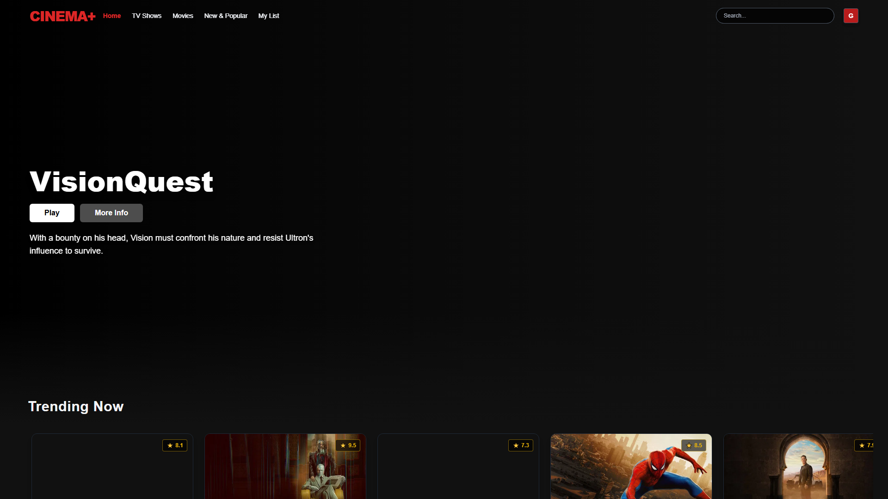
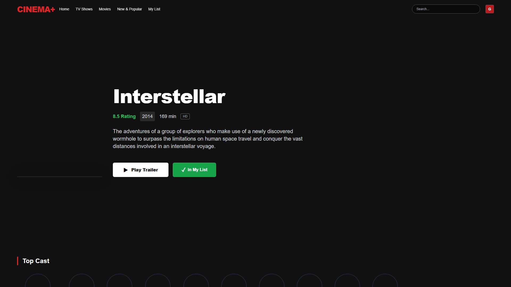
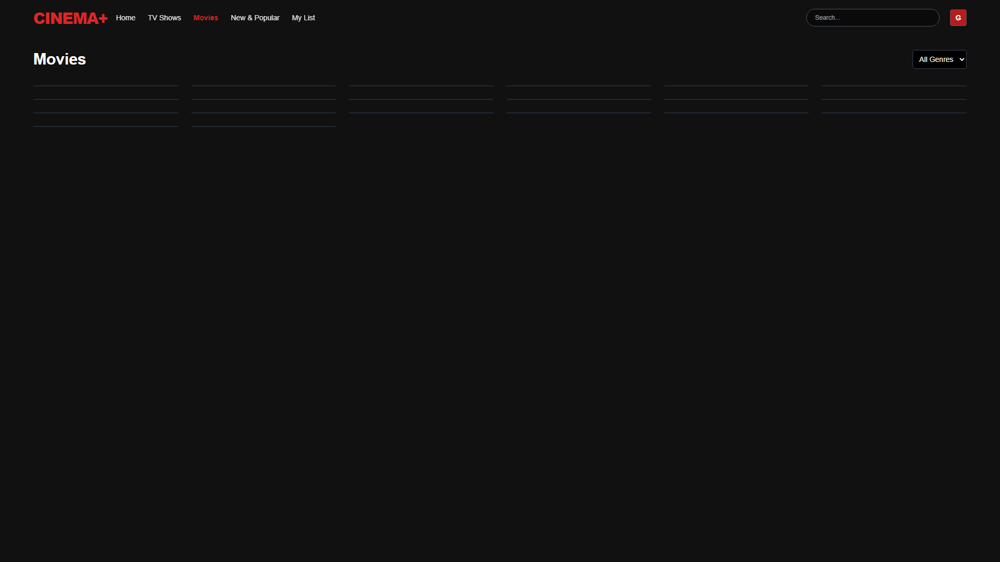
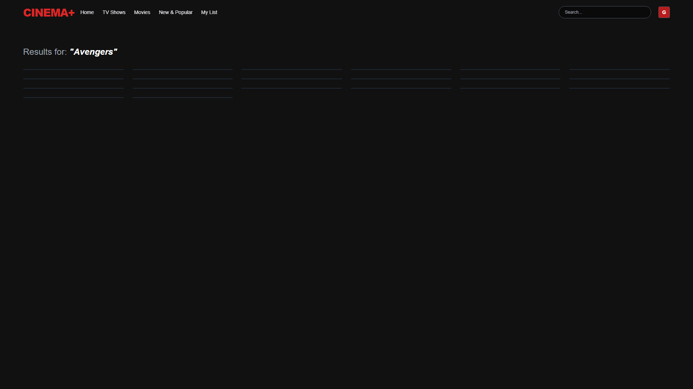
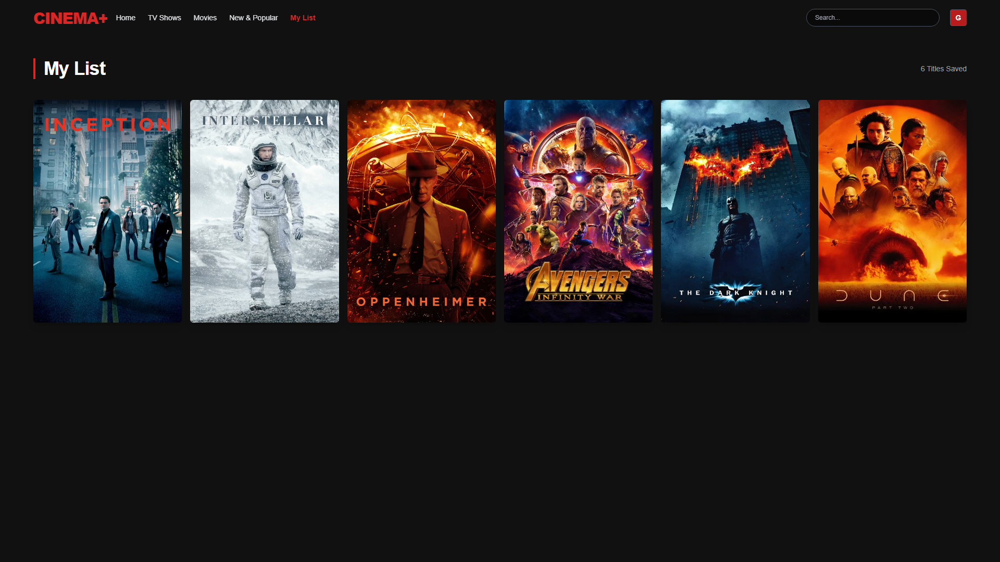

<div align="center">


</div>

<div align="center">

[](https://fady519.github.io/Cinema-Fady/)
[](https://github.com/Fady519/Cinema-Fady)
[](https://www.linkedin.com/in/fady-kaiser/)
[](https://fady519.github.io/MyPortfolio2/)

</div>

---

<div align="center">

## 🍿 Discover what's worth watching — instantly.
**A Netflix-inspired streaming discovery & entertainment platform powered by the TMDB REST API.**  
*React 19 · Vite · React Router 7 · Tailwind CSS · Framer Motion · React YouTube · Context API*  
Engineered with production-grade UI responsiveness, fluid micro-animations, multi-category exploration, and integrated HD trailer streaming.

</div>

---

## 🖥️ Live Preview

<div align="center">

> 🔗 **Live Demo:** [fady519.github.io/Cinema-Fady](https://fady519.github.io/Cinema-Fady/)

</div>

### 1. Hero Spotlight & Real-Time Trending Carousels
Dynamic backdrop hero featuring randomized trending titles, instant playback triggers, synopsis previews, and categorized horizontal scrolling rows.


### 2. Immersive Details, Cast Lineup & Interactive Trailer Integration
Deep-dive movie intelligence displaying high-res key art, synopsis, release metadata, vote ratings, full cast carousel, and embedded YouTube trailer streaming.


### 3. Dynamic Genre Filtering & Infinite Exploration Catalog
Comprehensive media catalog with multi-genre dropdown filtering (Action, Comedy, Horror, Romance, Sci-Fi, Thriller) and responsive card scaling.


### 4. Multi-Entity Real-Time Search with Live Filtering
Instant multi-match search engine parsing movies, TV series, and media titles with real-time query parameters and fallback artwork handling.


### 5. LocalStorage-Backed Persistent Watchlist ("My List")
Client-side state persistence allowing users to bookmark and manage their personal watchlist across sessions without external authentication bottlenecks.


---

## ✨ Key Features

| Feature | Description |
|---|---|
| 🔥 **Hero Spotlight Banner** | Automated random showcase of high-rated weekly trending releases with dynamic high-resolution backdrops |
| 🎬 **Live HD Trailer Player** | Embedded video playback engine powered by `react-youtube` fetching official TMDB teaser & trailer keys |
| 🔍 **Multi-Entity Search Engine** | Fast multi-search query matching against TMDB database with URL query string synchronization |
| 🎭 **Multi-Genre Exploration** | Dedicated Movies & TV Shows explorers with genre filtering across 10+ cinematic categories |
| ❤️ **Persistent Watchlist (My List)** | Client-side bookmarking engine storing favorite movies and shows with instantaneous reactive toggling |
| 🔐 **Client Auth Gate & Route Guard** | Protected route wrapper guarding content views, profile settings, and personal watchlists |
| 💀 **Shimmer Loading Skeletons** | Polished skeleton states mimicking layout geometry to prevent content layout shifts (CLS) |
| 📱 **Mobile-First Responsive UI** | Custom Tailwind grid system adapting seamlessly from mobile handhelds to ultra-wide 4K monitors |
| ⚡ **Vite + React 19 Modern Architecture** | Sub-second cold starts, optimized ESM bundles, and modern React 19 functional hooks |

---

## 🏗️ Architecture & Component Flow

```
┌────────────────────────────────────────────────────────┐
│                   Cinema+ Platform                     │
│               React 19 + React Router 7                │
└───────────────────────────┬────────────────────────────┘
                            │
       ┌────────────────────┴────────────────────┐
       ▼                                         ▼
┌──────────────┐                          ┌──────────────┐
│ Public Gate  │                          │  Protected   │
│ SignIn/SignUp│                          │ Content Hub  │
└──────────────┘                          └──────┬───────┘
                                                 │
          ┌───────────────────────┬──────────────┴───────────────┬──────────────────────┐
          ▼                       ▼                              ▼                      ▼
   ┌─────────────┐        ┌──────────────┐               ┌──────────────┐        ┌──────────────┐
   │ Home & Hero │        │ Explore Grid │               │ Media Detail │        │  Watchlist   │
   │ Row Sliders │        │ Multi-Genre  │               │ & HD Player  │        │ (My List)    │
   └──────┬──────┘        └──────┬───────┘               └──────┬───────┘        └──────┬───────┘
          │                      │                              │                       │
          └──────────────────────┴───────────────┬──────────────┴───────────────────────┘
                                                 ▼
                              ┌──────────────────────────────────┐
                              │     TMDB REST API Services       │
                              │ Trending · Discover · Credits    │
                              │ Videos · Multi-Search            │
                              └──────────────────────────────────┘
```

---

## 🔌 TMDB API Integration

Cinema+ consumes **8 high-throughput REST endpoints** from [The Movie Database (TMDB) API](https://developer.themoviedb.org/docs):

```
Base URL: https://api.themoviedb.org/3
```

| Endpoint | Method | Purpose & Usage in Cinema+ |
|---|---|---|
| `/trending/all/week` | `GET` | Powers the randomized hero spotlight and top trending slider |
| `/discover/movie` | `GET` | Fetches filtered catalog movies with sorting and genre IDs |
| `/discover/tv` | `GET` | Fetches TV shows and streaming series |
| `/movie/top_rated` | `GET` | Populates the top-rated critically acclaimed movie row |
| `/search/multi` | `GET` | Real-time search query matching across all titles |
| `/movie/{id}` | `GET` | Retrieves full movie metadata, runtime, overview, and budget |
| `/movie/{id}/credits` | `GET` | Retrieves director and top 10 cast members with profile photos |
| `/movie/{id}/videos` | `GET` | Resolves official YouTube trailer video keys for HD playback |

---

## 🛠️ Tech Stack & Libraries

<div align="center">

### Frontend Core & UI


### Media & Networking


</div>

---

## 📁 Project Structure

```
Cinema-Fady/
├── docs/
│   └── screenshots/              # High-resolution production showcase captures
│       ├── 01_hero_trending.png
│       ├── 02_movie_details.png
│       ├── 03_genre_catalog.png
│       ├── 04_search_modal.png
│       └── 05_watchlist.png
├── public/                       # Static public assets & favicons
├── src/
│   ├── components/               # Modular UI building blocks
│   │   ├── AuthInput.jsx         # Reusable floating label input
│   │   ├── ExploreGrid.jsx       # Multi-category media grid with genre select
│   │   ├── Footer.jsx            # Cinema+ footer with brand links
│   │   ├── MovieDetail.jsx       # Metadata, backdrop, cast & actions
│   │   ├── Navbar.jsx            # Responsive navigation & search input
│   │   ├── Row.jsx               # Horizontal movie poster carousel
│   │   └── ScrollToTop.jsx       # Automated route scroll reset
│   ├── pages/                    # Route-level views
│   │   ├── Account.jsx           # User profile & preferences
│   │   ├── Help.jsx              # Customer support & FAQ
│   │   ├── Home.jsx              # Hero showcase & trending rows
│   │   ├── Movies.jsx            # Discover movies catalog
│   │   ├── MyList.jsx            # LocalStorage personal watchlist
│   │   ├── NewAndPopular.jsx     # Latest releases & buzz titles
│   │   ├── NotFound.jsx          # Custom 404 error experience
│   │   ├── Player.jsx            # HD YouTube trailer streaming player
│   │   ├── Search.jsx            # Live query results explorer
│   │   ├── SignIn.jsx            # Access portal & authentication
│   │   ├── SignUp.jsx            # User registration portal
│   │   └── TVShows.jsx           # Discover television series
│   ├── routes/
│   │   └── AppRoutes.jsx         # HashRouter routing table & route guards
│   ├── App.jsx                   # Root layout & navbar conditional visibility
│   ├── index.css                 # Tailwind directives & custom animations
│   └── main.jsx                  # React 19 root bootstrap
├── index.html                    # HTML5 application shell
├── package.json                  # NPM dependencies & deploy scripts
├── tailwind.config.js            # Design tokens & color extensions
└── vite.config.js                # Vite build configuration
```

---

## ⚙️ Getting Started

### Prerequisites

- [Node.js](https://nodejs.org/) `v18.0.0` or higher
- [TMDB API Key](https://www.themoviedb.org/settings/api) *(Free registration)*

### Installation & Local Setup

```bash
# 1. Clone the repository
git clone https://github.com/Fady519/Cinema-Fady.git
cd Cinema-Fady

# 2. Install dependencies
npm install

# 3. Start local development server
npm run dev
```

Open [http://localhost:5173](http://localhost:5173) in your browser to view the application.

### Production Build & Deployment

```bash
# Build optimized static bundle
npm run build

# Deploy directly to GitHub Pages
npm run deploy
```

---

## 📬 Contact & Connect

<div align="center">

[](https://www.linkedin.com/in/fady-kaiser/)
[](https://github.com/Fady519)
[](https://fady519.github.io/MyPortfolio2/)

</div>

---

<div align="center">


**⭐ If you liked Cinema+, feel free to give it a star on GitHub!**

</div>
